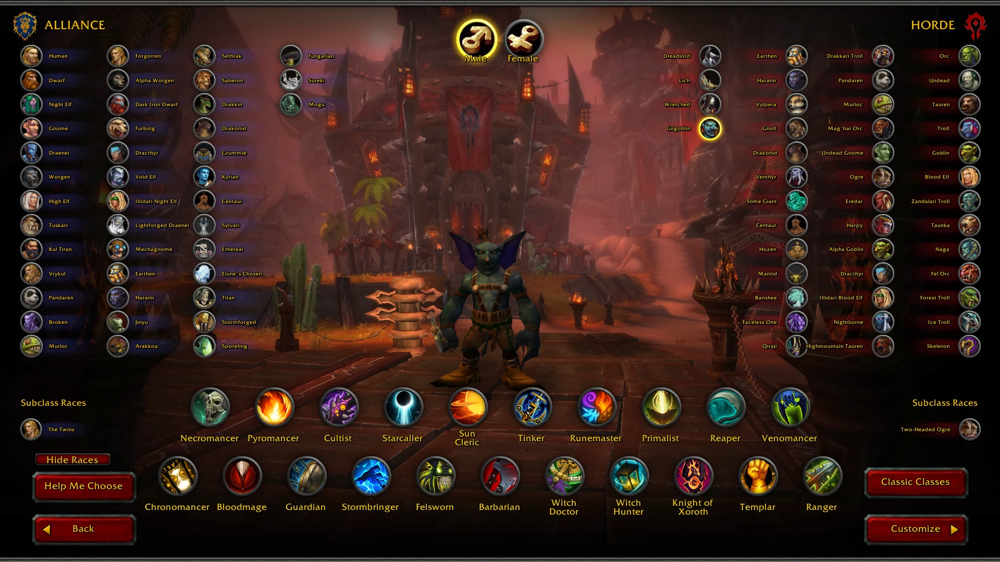

> **Download:** the [latest release](../../releases/latest) (V2): every zip on that page, one folder, then `Install-Custom.bat`.

# CoA Custom Races V2



Every custom race for Conquest of Azeroth (AzerothCore server + the CoA custom client), plus everything built since 1.9.9:
Gilgoblin, the restored Fading Island (boats, elevators, NPCs), Lumenveil graphics, retail mounts and pets, the in-game dev menu,
class incarnations and a lot of fixes.

**Video:** [docs/showcase.mp4](docs/showcase.mp4) (5 minutes, 1080p)

## Download
Releases page, **V2**: `CoA-Custom-V2-Server.zip` + `CoA-Custom-V2-Client-1..9.zip`. Extract all of them into one folder and run
`CoA-Custom\Install-Custom.bat`. Start the game with `CoACustomRace.exe`. Steps: [docs/INSTALL-GUIDE.txt](docs/INSTALL-GUIDE.txt).
Back up your characters first. What changed: [docs/PATCH-NOTES-V2.txt](docs/PATCH-NOTES-V2.txt).

## What is in V2
- **One client**: `CoACustomRace.exe`. Vulkan renderer with Lumenveil lighting / fog and the HD water and material passes.
- **80 race entries**, every id and credit in [RACES.md](RACES.md) and [docs/CoA-Custom-Races-V2-Credits.xlsx](docs/CoA-Custom-Races-V2-Credits.xlsx).
- **Gilgoblin** (the Unshackled, race 105) with racials.
- **Fading Island restore**: 2 boats (Booty Bay and Ratchet to Hardluck), 4 elevators, goblin passengers, spirit healer, teleports.
- **Retail mounts and pets**: about 1700 mounts, 2600 battle pets.
- **Dev menu**: `/dev` in-game editor for NPCs, items, quests, shops, paths and objects.
- **Incarnations**: every slot open to every class; Venomancer, Bloodmage, Reaper, Starcaller, Felsworn, Pyromancer, Necromancer,
  Cultist, Primalist, Tinker, Witch Hunter, Barbarian and Stormbringer forms and pets. See the release's `INCARNATIONS.md`.
- **Vanilla class health** matched to the CoA classes (levels 2 to 60).
- **Fixes**: Sylvari, Centaur and Faceless animations, Tuskarr ankle, white / green Saberon and Drakonid, bot freezes.

This repo is the source of the **CoACustomRace** client (based on Sven Bledt's CoA client port, shared here with written permission) and the
tools around it. The development notes of the original project follow below.

---

#  AzerothCore

[](CODE_OF_CONDUCT.md)
[](https://www.codefactor.io/repository/github/azerothcore/azerothcore-wotlk)
[](https://discord.gg/gkt4y2x "Our community hub on Discord")

## Build Status

[](https://github.com/azerothcore/azerothcore-wotlk/actions/workflows/core-build-nopch.yml?query=branch%3Amaster)
[](https://github.com/azerothcore/azerothcore-wotlk/actions/workflows/core-build-pch.yml?query=branch%3Amaster)
[](https://github.com/azerothcore/azerothcore-wotlk/actions/workflows/core_modules_build.yml?query=branch%3Amaster)
[](https://github.com/azerothcore/azerothcore-wotlk/actions/workflows/windows_build.yml?query=branch%3Amaster)
[](https://github.com/azerothcore/azerothcore-wotlk/actions/workflows/macos_build.yml?query=branch%3Amaster)
[](https://github.com/azerothcore/azerothcore-wotlk/actions/workflows/docker_build.yml?query=branch%3Amaster)
[](https://github.com/azerothcore/azerothcore-wotlk/actions/workflows/tools_build.yml?query=branch%3Amaster)
[](https://github.com/azerothcore/azerothcore-wotlk/actions/workflows/dashboard-ci.yml?query=branch%3Amaster)

## Introduction

AzerothCore is an open-source game server application and framework designed for hosting massively multiplayer online role-playing games (MMORPGs). It is based on the popular MMORPG World of Warcraft (WoW) and seeks to recreate the gameplay experience of the original game from patch 3.3.5a.

The original code is based on MaNGOS, TrinityCore, and SunwellCore and has since then had extensive development to improve stability, in-game mechanics, and modularity to the game. AC has also grown into a community-driven project with a significant number of contributors and developers. It is written in C++ and provides a solid foundation for creating private servers that mimic the mechanics and behavior of the official WoW servers.

## Philosophy

Our main goal is to create a playable game server, offering a fully working in-game experience.

Here are the main points we focus on:

* Stability
  * We make sure all changes pass the CIs before being merged into the master branch.

* Blizzlike content
  * We strive to make all in-game content to be blizzlike. Therefore we have a high standard for fixes being made.

* Customization
  * It is easy to customize your experience using [modules](#modules).

* Community driven
  * AzerothCore has an active community of developers, contributors, and users who collaborate, share knowledge, and provide support through forums, Discord channels, and other communication platforms. 

### Modules

AzerothCore is designed to be highly modular, allowing developers to extend and customize the game to suit their preferences or create unique gameplay experiences. This flexibility enables the addition of custom features, content, and modifications.

We have a lot of modules already made by the community, many of which can be found in the [Module Catalogue](https://www.azerothcore.org/catalogue.html#/).

## Installation

For this CoA fork, install the [world database package](../apps/coa-world/README.md)
into an empty world schema before the first worldserver startup.

Detailed installation instructions are available [here](http://www.azerothcore.org/wiki/installation).

## Contributing

AzerothCore can also serve as a learning resource for aspiring developers who want to understand how WoW servers work, how MMORPGs are structured, how game server emulators are created, or to improve their C++ and SQL knowledge.

If you want to contribute to the project, you will find a lot of resources that will guide you in our [wiki](https://www.azerothcore.org/wiki/contribute).

We also recommend you read our [Contributor Covenant Code of Conduct](https://github.com/azerothcore/azerothcore-wotlk/blob/master/.github/CODE_OF_CONDUCT.md).

Feel free to join our [Discord server](https://discord.gg/gkt4y2x).

🤖 If you use any AI agent to work on AzerothCore, please read our [AI Agentic Engineering guidelines](https://www.azerothcore.org/wiki/agentic-engineering).
Agent instructions for this repo live in [AGENTS.md](../AGENTS.md), with task-scoped guides in [.agents/docs/](../.agents/docs/); [.agents/README.md](../.agents/README.md) explains how to hook up your agent.

Click on the "⭐ Star" button to help us gain more visibility on GitHub!

## Authors & Contributors

The project was born in 2016 based on SunwellCore. Unfortunately, SunwellCore was published without any git history, so on git there are no credits for all the contributors before 2016.

You can check the [authors](https://github.com/azerothcore/azerothcore-wotlk/blob/master/AUTHORS) file for more details.

## Important Links

- [Doxygen documentation](https://www.azerothcore.org/pages/doxygen/index.html)
- [Website](http://www.azerothcore.org/)
- [AzerothCore catalogue](http://www.azerothcore.org/catalogue.html  "Modules, tools, and other stuff for AzerothCore") (modules, tools, etc...)
- [Our Discord server](https://discord.gg/gkt4y2x)
- [Our wiki](http://www.azerothcore.org/wiki "Easy to use and developed by AzerothCore founder")
- [Our forum](https://github.com/azerothcore/azerothcore-wotlk/discussions/)
- [Our Facebook page](https://www.facebook.com/AzerothCore/)
- [Our LinkedIn page](https://www.linkedin.com/company/azerothcore/)

## License

- The AzerothCore source code is released under the [GNU GPL v2](https://www.gnu.org/licenses/old-licenses/gpl-2.0.en.html)

It's important to note that AzerothCore is not an official Blizzard Entertainment product, and it is not affiliated with or endorsed by World of Warcraft or Blizzard Entertainment. AzerothCore does not in any case sponsor nor support illegal public servers. If you use this project to run an illegal public server and not for testing and learning it is your own personal choice.

## Special thanks

[JetBrains](https://www.jetbrains.com/?from=AzerothCore) is providing free [open-source licenses](https://www.jetbrains.com/community/opensource/) to the AzerothCore developers.

[](https://jb.gg/OpenSourceSupport)

---

# CoA64 (client)

A native 64-bit client for Conquest of Azeroth: the WoW 3.3.5a (build 12340) client with the functionality of
CoA's `Extensions.dll` built in.

It is built on two upstream sources (see `UPSTREAM.md`):

- **wowdecomp**, a C++ decompilation of the 3.3.5a client whose 64-bit build is a complete client. Every function
  keeps its original address in an `// OFFSET:` tag. Its README is kept at `docs/wowdecomp-README.md`.
- **ascension-extensions-reconstruction**, the function-by-function reconstruction of `Extensions.dll`.
  Its features are ported into `CoA/Source`. Each place where decomp code was changed for CoA carries a
  `// CoA:` comment naming the original hook or patch address.

Design: `docs/superpowers/specs/2026-10-25-coa64-client-design.md`. Deliberate differences from the 32-bit
client: `CoA/DIFFERENCES.md`.

## Building

Visual Studio 2022 (Desktop development with C++), from an 64-bit developer prompt:

```bat
cmake -G Ninja -DCMAKE_BUILD_TYPE=RelWithDebInfo -S . -B out\build\x64-Release
cmake --build out\build\x64-Release --target Wow
```

Output: `bin\Win\CoA64.exe` (+ `.pdb`, `.map`) and `XvidDecoder.dll`. `BuildCoA64.bat` builds and packages a zip.

## Running

Copy `CoA64.exe` and `XvidDecoder.dll` into a CoA client folder (next to `Ascension.exe`, which is left untouched)
and start `CoA64.exe` from there. `-extlog 1` turns on the developer log `Logs\Extensions.log`.

## License

Proprietary — all rights reserved. No one may copy, distribute or modify this code without written permission;
see `LICENSE`. Third-party and upstream material keeps its own licenses; see `NOTICE.md`.
